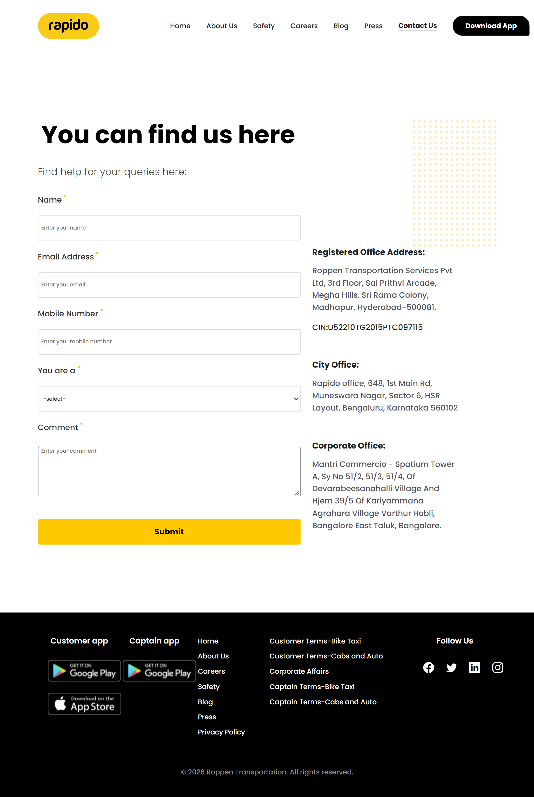

# Rapido Contact Page Clone

A responsive frontend recreation of Rapido's Contact Us page, built with HTML5, CSS3 and Bootstrap 5.

[**Live Demo**](https://ammucodes.github.io/rapido-contact-clone/)

## Full Page Preview



> Independent educational project. Not affiliated with or endorsed by Rapido. All trademarks and brand assets belong to their respective owners.

## Tech Stack

- HTML5
- CSS3 (Flexbox, media queries, transforms and transitions)
- Bootstrap 5.3.8
- Bootstrap Icons
- Google Fonts (Poppins)

## Features

- Responsive desktop and mobile layouts.
- Custom navigation with active-link styling.
- CSS-only mobile slide-in navigation drawer — **no JavaScript**.
- Contact form with native HTML validation.
- Registered, city and corporate office sections.
- Multi-section footer with app download links and social icons.

## Technical Highlight: CSS-Only Navigation

The mobile navigation drawer uses the **checkbox hack** to manage its open and closed states entirely through CSS.

- A single checkbox controls the menu state.
- Three associated labels handle opening, closing and backdrop interaction.
- The CSS general sibling combinator (`~`) targets the drawer and backdrop.
- `transform: translateX()` and CSS transitions create the slide-in animation.
- Fixed positioning and layered `z-index` values manage the drawer and backdrop.

**Core CSS implementation:**

```css
.mobile_menu {
  transform: translateX(100%);
  transition: transform 0.35s ease;
}

.nav-toggle-checkbox:checked ~ .mobile_menu {
  transform: translateX(0);
}
```

## Responsive Behaviour

| Viewport | Layout |
|---|---|
| Below 992px | Mobile navigation and single-column contact layout |
| 992px–1199px | Desktop navigation and two-column contact layout |
| 1200px+ | Desktop layout with a 1170px content container |

*Intermediate desktop navbar spacing is still being refined.*

## Project Structure

```text
rapido-contact-clone/
├── assets/
│   └── img/
├── css/
│   ├── style.css
│   └── responsive.css
├── docs/
│   └── screenshots/
│       └── preview.png
├── index.html
└── README.md
```

## Run Locally

```bash
git clone https://github.com/ammucodes/rapido-contact-clone.git
cd rapido-contact-clone
```

Open `index.html` in your browser or use VS Code Live Server.


## Credits

[Rapido](https://www.rapido.bike/) · [Bootstrap](https://getbootstrap.com/) · [Bootstrap Icons](https://icons.getbootstrap.com/) · [Poppins](https://fonts.google.com/specimen/Poppins)

## Author

**ammucodes** · [GitHub](https://github.com/ammucodes) · [LinkedIn](https://www.linkedin.com/in/ammucodes/)